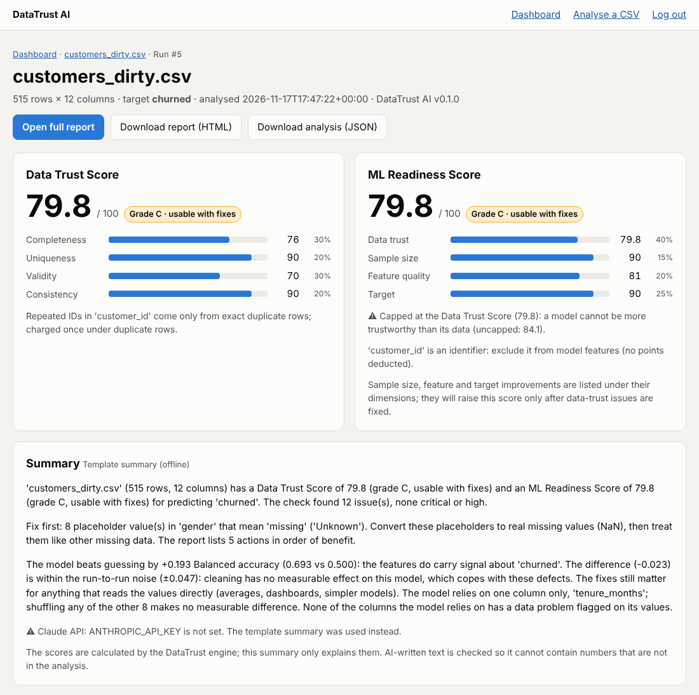
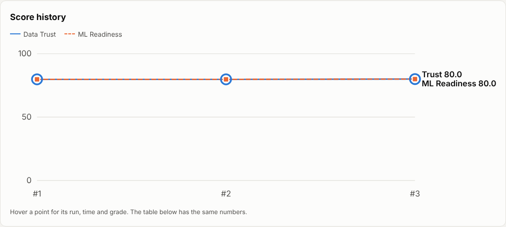
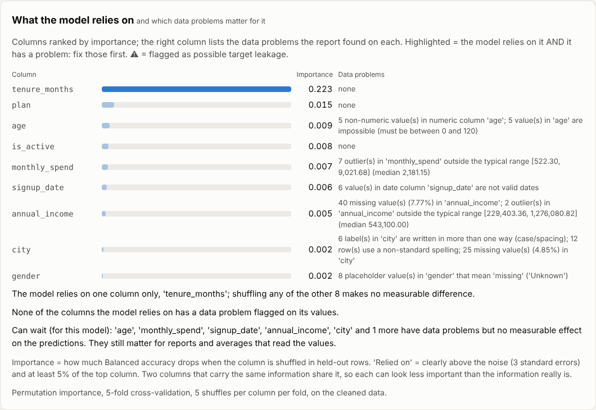

# DataTrust AI

**Can this data be trusted, and is it ready for machine learning?** Upload a CSV and DataTrust AI tells you,
with a score, the reasons behind every lost point, a real model trained on it, and a plain-language summary.



- **Data Trust Score** (0-100): completeness, uniqueness, validity, consistency.
- **ML Readiness Score** (0-100): data trust, sample size, feature quality, target. Capped at Data Trust:
  a model cannot be more trustworthy than its data.
- **Every point explained**: each deduction names the issue, the column, the rows and the fix, ranked by gain.
- **Checked against a real model**: trains gradient boosting on the raw and on the cleaned data, next to a
  model that just guesses, with noise-aware verdicts.
- **What the model relies on**: permutation importance joined with the data problems, so you know which fix comes first.
- **Plain-language summary**: offline template, a free local AI (Ollama) or the Claude API; AI text is checked
  against the verified numbers before it is shown.
- **Web app + history**: Django dashboard, background analyses, login, score history per dataset in MySQL.

Built in 10 phases, each tested; 400+ automated tests. What changed when: [CHANGELOG.md](CHANGELOG.md).
How it works and why: [docs/ARCHITECTURE.md](docs/ARCHITECTURE.md).

## What it finds

| Area | Examples |
|---|---|
| Missing data | empty cells, and *disguised* missing values: `Unknown`, `N/A`, `-999`, blanks |
| Validity | text in number columns, impossible values (age 150), dates like 30 February |
| Consistency | `Chennai` / `chennai ` / `CHENNAI`, numbers written as words |
| Duplicates | exact duplicate rows, duplicates hidden behind a unique ID, repeated IDs |
| Columns | constant columns, identifiers, outliers, skew |
| ML risks | class imbalance, tiny samples, redundant features, **possible target leakage** |

## Quick start (Windows)

```powershell
git clone https://github.com/Kalai-coder-DS/DataTrust-AI datatrust-ai
cd datatrust-ai
python -m venv .venv
.venv\Scripts\activate
pip install -r requirements.txt
python -m pytest                                   # all tests, offline (about 3-5 minutes)
```

macOS / Linux: `source .venv/bin/activate` instead of the activate line.
If `python` points to another installation on Windows, use `.venv\Scripts\python.exe`.

### Command line

```bash
python main.py data/sample/customers_dirty.csv                                   # profile + quality + scores
python main.py data/sample/customers_dirty.csv --target churned                  # + target checks
python main.py data/sample/customers_dirty.csv --target churned --baseline       # + train the baseline model
python main.py data/sample/customers_dirty.csv --target churned --baseline --summary   # + plain-language summary
python main.py data/sample/customers_dirty.csv --target churned --html reports/dirty.html   # shareable report
python main.py data/sample/customers_dirty.csv --json reports/dirty.json         # everything as JSON
python main.py data/sample/customers_dirty.csv --target churned --save           # store the run in MySQL
python scripts/db.py history customers_dirty.csv                                  # score history of a dataset
python scripts/generate_sample_data.py                                            # recreate the sample files
```

### Web app

```bash
python webapp/manage.py runserver          # open http://127.0.0.1:8000/
```

| Page | What it shows |
|---|---|
| Dashboard | every dataset with its latest scores |
| Analyse a CSV | upload, target column, baseline model, summary provider; runs in the background |
| Dataset history | score trend over every run, and whether the data changed between runs |
| Run | scores, summary, top actions, baseline model, what the model relies on, every issue |
| Full report / JSON | the self-contained HTML report and the complete analysis |



## Setup

**Database (MySQL).** Copy `.env.example` to `.env`, put your MySQL password in it, then run
`python scripts/db.py init` to create the `datatrust` database and its tables. `.env` is git-ignored.
No MySQL server? Leave out `DATATRUST_DB` (or set it to `sqlite`) and a local SQLite file is used.

**Login.** Set `DATATRUST_WEB_PASSWORD=...` in `.env`, and every page asks for it. Without it, the app is open
(fine on your own computer: it only answers on `localhost`). Production mode (`DATATRUST_DEBUG=0`) refuses
to start without a password and a `DATATRUST_SECRET_KEY`.

**Plain-language summaries** (all optional):

| Provider | Needs | Notes |
|---|---|---|
| `template` | nothing | always works; offline, instant, same text every time |
| `ollama` | [Ollama](https://ollama.com) + `ollama pull llama3.2:3b` | free, local, no account; data never leaves the computer; slow without a GPU |
| `claude` | `ANTHROPIC_API_KEY` in `.env` | paid per use; best writing |
| `auto` | — | Claude if a key is set, else Ollama if running, else template |



## How it is built

```
CSV ─► ingestion ─► profiling ─► quality checks ─► statistics ─► scores ─┬─► CLI / HTML report / JSON
                                                                         ├─► storage (MySQL / SQLite)
                                     baseline model ─► importance ───────┤
                                                summary (template / Ollama / Claude, guarded)
                                                                         └─► Django web app (background jobs, login)
```

Python 3.14 · pandas · scikit-learn · Django · MySQL (PyMySQL) · pytest. No JavaScript in the web pages.

### Design decisions worth asking about

1. **Explainable scores.** Every lost point is a listed deduction with a fix; the scores are reproducible
   from the issue list, not a black box.
2. **One data layer.** Django calls the project's own repository instead of ORM models, so the CLI and the
   web app share one definition of the tables.
3. **Measure, don't assume.** The baseline model checks whether cleaning really changes what a model learns,
   and judges every difference against the run-to-run noise. Found: on the sample file the effect of cleaning
   is within the noise, while duplicate rows make a raw score look better than it is.
4. **Verified against ground truth.** The sample's churn was generated from tenure only; the importance step
   finds exactly that column, for every random seed tested.
5. **AI explains, the engine decides.** All summary providers receive the same verified facts; AI text with a
   number not in the analysis, a wrong count or a misused severity word is rejected, and the template is used.
   Real local models were caught writing "seven problems" (12 exist) and "critical issues" (none exist).
6. **Safe by default.** Strict Content-Security-Policy, CSRF, escaped output, upload names never touch the disk,
   secrets only in `.env`, constant-time password checks, login throttling.
7. **Bugs found on real machines became tests:** file names illegal on Windows, `pd.NA` reaching scikit-learn
   with pandas 3.1, false "relied on" columns, a guard rejecting the correct "no critical issues".

## Configuration

All settings are environment variables (or lines in `.env`); no code changes needed.

| Variable | Default | Meaning |
|---|---|---|
| `DATATRUST_DB` | sqlite | `mysql` (as in `.env.example`) or `sqlite` |
| `DATATRUST_MYSQL_HOST` / `_PORT` / `_USER` / `_PASSWORD` / `_DATABASE` | localhost / 3306 / root / — / datatrust | MySQL connection |
| `DATATRUST_SQLITE_PATH` | data/datatrust.db | SQLite file |
| `DATATRUST_MAX_FILE_MB` | 200 | Upload size limit |
| `DATATRUST_CAT_MAX_UNIQUE` | 50 | Max distinct values for a categorical column |
| `DATATRUST_CAT_MAX_RATIO` | 0.05 | …or max distinct/rows ratio |
| `DATATRUST_LOG_LEVEL` | INFO | DEBUG / INFO / WARNING / ERROR |
| `DATATRUST_ML_MAX_ROWS` | 20000 | Baseline model: rows used (a class-stratified sample above this) |
| `DATATRUST_SUMMARY_PROVIDER` | auto | auto / template / ollama / claude |
| `ANTHROPIC_API_KEY` | (none) | Enables the Claude provider |
| `DATATRUST_CLAUDE_MODEL` | claude-haiku-5-5 | Claude model |
| `DATATRUST_OLLAMA_URL` | http://localhost:11434 | Ollama server |
| `DATATRUST_OLLAMA_MODEL` | llama3.2:3b | Local model |
| `DATATRUST_AI_TIMEOUT` | 120 | Seconds to wait for an AI answer (raise it for 7B models on a CPU) |
| `DATATRUST_DEBUG` | 1 | Web app: `0` for production settings |
| `DATATRUST_SECRET_KEY` | (dev key) | Web app: required when `DATATRUST_DEBUG=0` |
| `DATATRUST_ALLOWED_HOSTS` | localhost,127.0.0.1 | Web app: host names it answers to |
| `DATATRUST_WEB_PASSWORD` | (none) | Web app login; required when `DATATRUST_DEBUG=0` |
| `DATATRUST_WEB_BACKGROUND` | 1 | `0` analyses inside the request instead of in the background |
| `DATATRUST_WEB_WORKERS` | 2 | Analyses that can run at the same time |

## Known limitations

- Background analyses live in the web server's memory: a restart forgets analyses still running, and several
  server processes would not share them. A database-backed queue is the next step for a real deployment.
- One login for everyone; no user accounts or per-user datasets.
- Speed: about 3.6 seconds for 300,000 rows × 9 columns on a laptop, plus model training when asked for.
  Files are read fully into memory (200 MB upload limit).
- The summary guard checks numbers and key terms, not every word; the source (template / local AI / Claude)
  is always labelled.

## Tested on

Windows 11, Python 3.14.7, pandas 3.1, scikit-learn 1.9, Django 6.1, MySQL 8, Ollama (llama3.2:3b, qwen2.5:7b);
also Linux with pandas 3.0 (SQLite). On pandas 2.x, text columns show dtype `object` instead of `str` in
the report; behaviour is otherwise the same.
